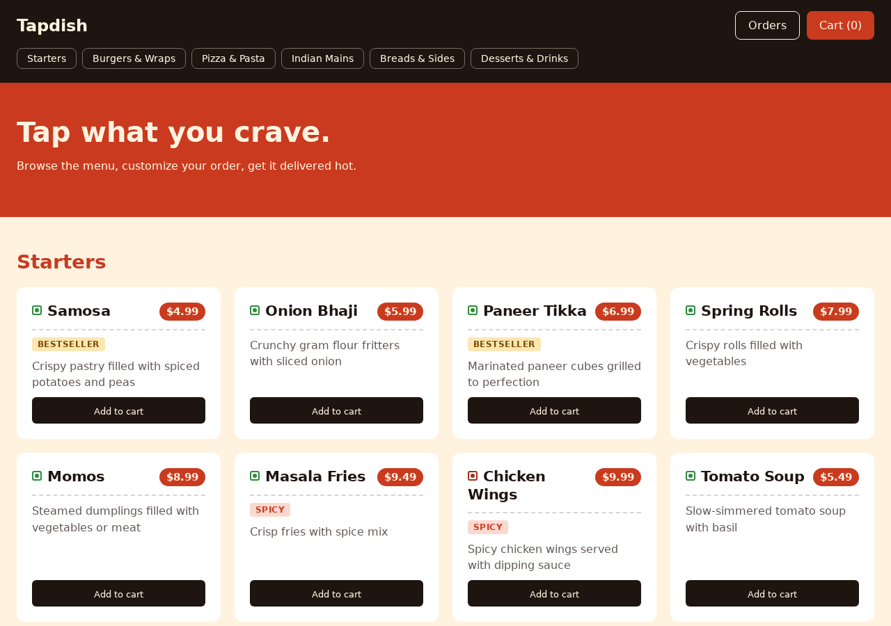

<div align="center">

# Tapdish

**Tap what you crave, we'll handle the rest.**

A food ordering web app with a 90-dish menu, a cart that remembers you, and a real backend that takes your order.


Live Preview: https://tapdish.senvor.dev/



Featured on the [XERJ Corpus Hub](https://hub.xerj.org/contributors/Senvor), which picked Tapdish as a code corpus for AI agents.

</div>

---

## What is it?

Tapdish is a restaurant ordering site. You scroll the menu, tap the dishes you want, check out with your name, email and address, and get an order number back. Orders go to a small Express server that checks everything and saves them.

The menu has **90 dishes across 6 categories**:

- Starters
- Burgers & Wraps
- Pizza & Pasta
- Indian Mains
- Breads & Sides
- Desserts & Drinks

## Features

- **Menu-style cards** with a veg / non-veg marker, Bestseller and Spicy tags, and a price pill
- **Category nav** that smooth-scrolls you straight to the section you want
- **Cart panel** that slides in, with + / - buttons and a live total
- **Cart saves itself** in your browser, so a refresh doesn't eat your order
- **Checkout form** that sends the order to the backend and shows your order number
- **Server-side checks**: the server looks up every price itself from the menu, so nobody can edit the page and get a $0 pizza
- **Orders view** for the restaurant side, locked behind an admin key
- Keyboard friendly: **Esc** closes the cart

## How to Use

1. Open the live preview
2. Pick a category or just scroll
3. Tap dishes to add them to your cart
4. Open the cart, adjust quantities, hit **Checkout**
5. Fill in your details and place the order

## Getting Started

### Dependencies

- [Node.js](https://nodejs.org/) 18 or newer
- Express 5 and cors (installed with npm)

### Installing

```
git clone https://github.com/Senvor/Tapdish.git
cd Tapdish
npm install
```

### Running it locally

```
node server.js
```

Then open http://localhost:3001

The server serves the frontend from `public/` and the API from the same port.

### Environment variables

| Variable | What it does | Default |
|---|---|---|
| `PORT` | Port the server runs on | `3001` |
| `ADMIN_KEY` | Key needed to view all orders | set your own! |

## API

| Method | Route | What it does |
|---|---|---|
| `POST` | `/api/orders` | Place an order. Body: `name`, `email`, `address`, `lines` (array of `{ id, qty }`). Returns the order number, name and total. |
| `GET` | `/api/orders` | List all orders. Needs the `x-admin-key` header. |

Orders are saved to `data/orders.json`.

## How it's hosted

- **Frontend**: GitHub Pages, deployed by a GitHub Actions workflow on every push to `main`, at [tapdish.senvor.dev](https://tapdish.senvor.dev/)
- **Backend**: Render, with CORS locked to the live site

## Tech Stack

- **HTML + CSS** - the page, the cart panel and the checkout popups
- **JavaScript** - menu rendering, cart logic and talking to the API
- **Node.js + Express** - the order API
- **GitHub Pages + GitHub Actions** - frontend hosting and deploys
- **Render** - backend hosting

## Project Structure

```
Tapdish/
├── public/
│   ├── index.html   # the page
│   ├── style.css    # all the styling
│   ├── script.js    # cart, checkout and orders logic
│   └── menu.js      # the 90-dish menu
├── server.js        # Express API
└── .github/workflows/pages.yml  # deploy to GitHub Pages
```

## Why I Built It

I wanted to build something with a real backend, not just a pretty page. A food ordering app felt perfect because it has everything: a menu to show, a cart to manage, a form to send and a server that has to trust nothing the browser says.

## What I Learned

- Building a REST API with Express
- Validating data on the server instead of trusting the frontend
- Saving state in `localStorage`
- CORS and splitting a frontend and backend across two hosts
- Auto-deploying with GitHub Actions

## License

This project is licensed under the [MIT License](LICENSE). You're free to use, modify, and share it, as long as the original copyright notice is kept.
